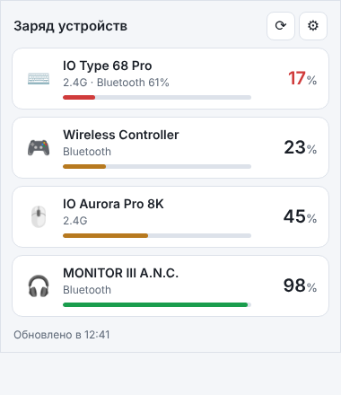
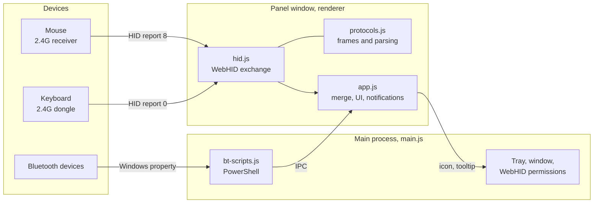

# IO Battery

**Battery level of your mouse, keyboard and headphones in the Windows tray.** One tray icon with the percentage of the weakest device, and a panel with all the others.

*[Русская версия](README.md)*



> **Status: experiment.** The project started as a test of one idea: can the battery level of IO / Red Square peripherals be read without the vendor's software? It works on the author's devices (see the [table](#verified-on-real-hardware)), but it is not a finished product: no code signing, no auto-update, and some features were only tested against mock data. Use at your own risk.

## Features

- Battery level of **IO Aurora / Nova and Red Square Kiro mice** over the 2.4G receiver or a cable.
- Battery level of **IO Type 68 / 84 and related keyboards** over the 2.4G dongle or a cable.
- **Any Bluetooth device that reports its battery to Windows** (what you see in *Settings → Bluetooth & devices*): headphones, keyboards, mice, gamepads.
- A device connected two ways (for example a keyboard over 2.4G and Bluetooth) appears as **one card**.
- A tray icon with the percentage of the weakest device, coloured by level.
- Low-battery notification (configurable threshold), autostart, an exchange log for diagnostics.
- If a device is asleep or disconnected, shows the **last known value with a note** instead of a made-up zero.
- Read-only: it never writes device settings and never uses the network.

## Verified on real hardware

| Device | Connection | Source | Status |
|---|---|---|---|
| IO Aurora Pro 8K | 2.4G receiver (`3554:FB40`) | WebHID, Compx protocol | works |
| IO Type 68 Pro | 2.4G dongle (`0C45:FEFE`) | WebHID, HFD protocol | works |
| IO Type 68 Pro | Bluetooth | Windows property | works |
| MONITOR III A.N.C. (headphones) | Bluetooth | Windows property | works |
| Other models from the [device tables](docs/PROTOCOLS.md#device-tables) | USB / 2.4G | WebHID | **untested**, IDs taken from the vendor's data |
| Gamepads and other Bluetooth devices | Bluetooth | Windows property | mock data only |
| Window transparency (Acrylic) | Windows 11 22H2+ | system window material | **untested** on a real Windows 11 |

If your model works (or doesn't), please open an issue and attach the log from the settings.

## Installation

### Prebuilt (portable)

1. Download `IO-Battery-win32-x64.zip` from Releases and extract the folder anywhere, for example `C:\Tools\IO-Battery`.
2. Run `IO Battery.exe`. The icon appears in the tray (possibly behind the `^` arrow). Click it to open the panel; right-click for the menu.
3. SmartScreen may warn about an unsigned app: "More info" → "Run anyway".
4. Close the IO Hub tab (`web.io.vision`) and the vendor's software: while they hold the device it may not answer this app.

### From source

Requires Node.js 20+ and Windows.

```bash
npm install
npm start          # run
npm test           # protocol tests (+ PowerShell script tests if PWSH=path\to\pwsh is set)
npm run dist       # installer and portable build with electron-builder
```

## How it works

### Overview



The app merges three data sources into one list:

1. **Mice (Compx)** and 2. **keyboards (HFD)** are read directly over **WebHID**, built into Chromium/Electron. The app sends a short battery request and waits for the reply. Frame formats are in [docs/PROTOCOLS.md](docs/PROTOCOLS.md).
3. **Bluetooth devices** are read through the battery value that Windows has already stored in a device property (`DEVPKEY_Bluetooth_Battery`). The app does not talk Bluetooth itself; it only asks the system.

### Code layout

| File | Role |
|---|---|
| `renderer/protocols.js` | Pure functions: build request frames, verify checksums, parse replies. No hardware access; tested in isolation. |
| `renderer/hid.js` | `HIDDevice` handling: choose the right interface from the descriptor, request/reply exchange with timeout and retries, per-device queue. |
| `renderer/app.js` | Polling loop, merging sources into cards, "last known value", notifications, settings, log. |
| `renderer/trayicon.js` | Draws the tray icon (percentage) on a canvas. |
| `main.js` | Panel window, tray, WebHID permissions, Bluetooth reading, autostart, window material. |
| `bt-scripts.js` | PowerShell scripts for Bluetooth. |
| `preload.js` | Narrow bridge between renderer and main process (`contextBridge`). |

### Polling

- Every N minutes (default 2; 1, 2, 5, 10 in settings), when the panel opens (if the data is older than 15 s), on the ⟳ button, and 2 s after a HID device is connected or disconnected.
- A device is opened **only for the duration of a read** and closed right after, which lowers the chance of clashing with vendor software.
- A request is retried up to 3 times; the reply is matched by command and address among incoming reports.
- Concurrent reads of the same device are queued.

### Merging into cards

Each reading gets a key and a "group name" (the name without suffixes such as `2.4G`, `Receiver`, `BT2`). Readings that share a group name form one card. The primary reading is the one that is:

1. fresh (the device answered just now);
2. has a value;
3. comes over a direct link (2.4G or USB) rather than Bluetooth;
4. newest.

The others are appended to the subtitle ("2.4G · Bluetooth 61%"). Cards are sorted weakest first.

### "No data" instead of zero

If a device did not answer, is asleep, or returned 0 % while not charging, the app **does not draw 0 %**. It shows the last known value with its time and a note ("asleep", "not connected", "no link"). Last values are kept in `localStorage` and survive restarts.

### Bluetooth through PowerShell

Windows stores a device's battery level in the property `{104EA319-6EE2-4701-BD47-8DDBF425BBE5},2` of a device node. One physical device has several nodes (root `BTHLE\DEV_…`, service nodes `BTHENUM\{…}`, child `HID\{…}` nodes of BLE keyboards) and the value can be on any of them. So:

- **Full scan** (first start, every 30 minutes, manual refresh if the last scan was over a minute ago): enumerates all PnP nodes, reads the battery property in one batched call, groups nodes by `ContainerId` (one physical device) and takes the readable name from the root node. Takes 10-20 s and runs **in the background**, so mice and keyboards are not blocked.
- **Quick poll** (all other times): reads only the already-found nodes. Takes a few seconds, most of it PowerShell start-up.
- If a quick poll returns nothing or fails, **the list is kept** and the next poll does a full scan.
- When no Bluetooth device with a battery is found, the full search repeats at most once every 10 minutes.

Drawback: every PowerShell call costs seconds, and `-EncodedCommand` with `ExecutionPolicy Bypass` tends to raise flags in antivirus/EDR products. A lighter path is described in [Possible improvements](#possible-improvements).

### Window and security

- The renderer runs with `contextIsolation`, no `nodeIntegration`, in a `sandbox`, with a `default-src 'self'` CSP.
- The only permission granted is `hid`. It is granted automatically with no picker, otherwise `navigator.hid.getDevices()` returns an empty list. The "Add manually" button uses the regular `requestDevice`.
- The app uses no network and collects no telemetry.
- On Windows 11 22H2+ (build 22621+) the window uses the system Acrylic material. There is a switch in the settings; on older systems the option is absent.

## Settings and diagnostics

The gear icon in the panel: polling interval, notification threshold, autostart, window transparency, **exchange log**.

If a device does not show up, enable the log, press "Copy log" and attach it to an issue. It shows:

- which HID interfaces were found (`page … usage … in=[id:size] out=[id:size]`);
- which frames were sent (`→`) and what came back (`←`);
- the parsed result and the reason for a failure.

## Known limitations

- Windows only (the Bluetooth part relies on PowerShell and the Windows device manager).
- Electron uses a lot of memory: on the order of a hundred megabytes or more. That is heavy for a tray utility; see [plans](#possible-improvements).
- Sleeping devices do not answer battery requests; the app shows the last known value.
- The refresh button spins as a whole while polling, not just its glyph (cosmetic).
- The build is unsigned.
- Support for models other than those in the table above is based on data from the vendor's web client and is untested.

## Adding your own device

1. Connect the device, enable the exchange log and look at which HID interfaces the app sees. You are looking for vendor pages (`0xFF00` and above) with an input/output report pair.
2. Open the manufacturer's configurator and, if it uses WebHID, watch the reports in DevTools while it shows the battery. Many configurators reuse protocols that are already documented here.
3. Add frame building and reply parsing to `protocols.js`, interface detection and reading to `hid.js`. The `compx*` and `hfd*` functions are good templates.
4. Add tests against mock data to `tests/test.js`; a mock HID device is already there.

## Development

```bash
npm test                          # protocol and exchange tests on mock HID devices
PWSH=/path/to/pwsh npm test       # plus PowerShell script checks against mock cmdlets
```

- `tests/test.js` covers the protocols, interface selection from real descriptors, and exchanges with emulated mouse and keyboard firmware.
- `tests/bt.test.js` runs the Bluetooth PowerShell scripts against mock `Get-CimInstance` and `Get-PnpDeviceProperty` (needs PowerShell 7; real Windows and PowerShell 5.1 are not covered).
- `scripts/smoke.js` and `scripts/smoke-bt.js` launch real Electron under a virtual display (`xvfb`), replace `navigator.hid` with mock devices and take screenshots. Bluetooth mocking for development: the `IOBAT_FAKE_BT` and `IOBAT_FAKE_BT_SEQ` environment variables.

### Building a release on Windows

```bash
npm install
npm run dist
```

The output appears in `dist/`:

| File | What it is |
|---|---|
| `IO Battery 0.1.0.exe` | portable: a single file that unpacks to a temp folder on every start (slightly slower start-up) |
| `IO Battery Setup 0.1.0.exe` | installer (NSIS, per-user, no admin rights) |
| `win-unpacked/` | a plain app folder, like the portable archive below |

Build just one format with `npx electron-builder --win portable`, `--win nsis` or `--win dir`.

- **Icon:** put `build/icon.ico` (256×256) in place and `electron-builder` picks it up.
- **Symbolic link error** while downloading `winCodeSign`: enable Windows Developer Mode or run the terminal as administrator. If you do not need the exe icon and metadata you can skip that step with `-c.win.signAndEditExecutable=false`.
- Code signing is not configured; without it SmartScreen will warn.
- Building from Linux was verified only for `win-unpacked` and portable (with `signAndEditExecutable=false`); NSIS on Linux needs Wine.

### How the portable archive is built

On Windows just run `npm run dist`. From Linux the archive is assembled by hand: take the official Windows Electron build (`electron-v*-win32-x64.zip`), rename `electron.exe`, put the app into `resources/app` and delete `default_app.asar`.

## Possible improvements

- **Drop PowerShell:** read the same property directly through the Configuration Manager API (`CM_Get_DevNode_PropertyW`). Milliseconds instead of seconds, and no dependence on the PowerShell version.
- **Lower memory use:** Electron drags in Chromium. C# on .NET, Rust or Tauri fit this task better; the protocols are already pure functions and port easily.
- Sign the build, add auto-update.
- Listen to events that devices push on their own (for example a mode change) instead of polling.

## Legal

- This is an independent project and is **not affiliated** with IO, Red Square, Compx, Microsoft or other trademark owners mentioned; names are used only to describe compatibility.
- The frame formats were reconstructed from observed device traffic and from the client-side code of a public web configurator, for interoperability with hardware the author owns. No vendor code or assets are included in this repository.
- The app only sends battery-level read requests to devices.
- The software is provided "as is", without warranty.

## License

[MIT](LICENSE)
