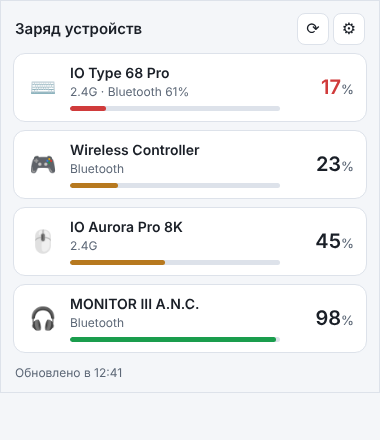
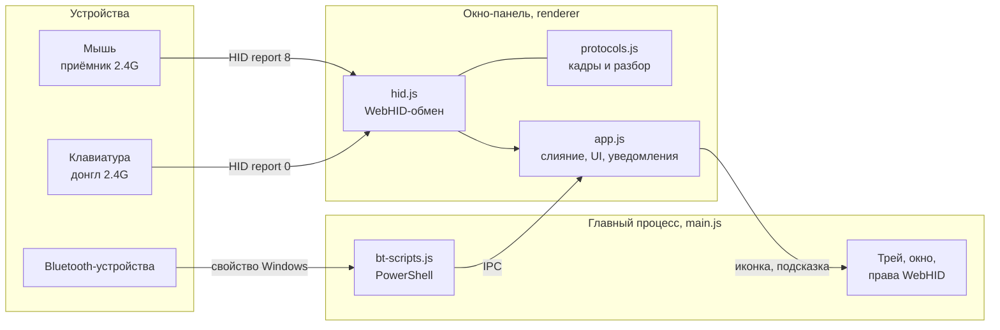

# IO Battery

**Заряд мыши, клавиатуры и наушников в трее Windows.** Одна иконка с числом процентов у самого разряженного устройства и панель со всеми остальными.

*[English version](README.en.md)*



> **Статус: эксперимент.** Проект родился как проверка идеи «можно ли вытащить заряд из периферии IO / Red Square без родного софта». Он работает на устройствах автора (см. [таблицу](#проверено-на-реальном-железе)), но это не продукт: нет подписи кода, нет автообновления, а часть возможностей проверена только на подставных данных. Используйте на свой риск.

## Что умеет

- Показывает заряд **мышей IO Aurora / Nova и Red Square Kiro** через приёмник 2.4G или кабель.
- Показывает заряд **клавиатур IO Type 68 / 84 и родственных** через донгл 2.4G или кабель.
- Показывает **любые Bluetooth-устройства, которые сами сообщают заряд Windows** (то, что видно в «Параметры → Bluetooth и устройства»): наушники, клавиатуры, мыши, геймпады.
- Одно устройство, подключённое двумя способами (например, клавиатура по 2.4G и по Bluetooth), показывается **одной карточкой**.
- Иконка в трее с числом процентов самого разряженного устройства, цвет зависит от уровня.
- Уведомление о низком заряде (порог настраивается), автозапуск, журнал обмена для диагностики.
- Если устройство спит или отключено, показывает **последнее известное значение с пометкой**, а не выдуманный ноль.
- Только читает: ничего не записывает в настройки устройств, не ходит в сеть.

## Проверено на реальном железе

| Устройство | Подключение | Источник | Статус |
|---|---|---|---|
| IO Aurora Pro 8K | приёмник 2.4G (`3554:FB40`) | WebHID, протокол Compx | работает |
| IO Type 68 Pro | донгл 2.4G (`0C45:FEFE`) | WebHID, протокол HFD | работает |
| IO Type 68 Pro | Bluetooth | свойство Windows | работает |
| MONITOR III A.N.C. (наушники) | Bluetooth | свойство Windows | работает |
| Остальные модели из [таблиц протоколов](docs/PROTOCOLS.md#device-tables) | USB / 2.4G | WebHID | **не проверены**, идентификаторы взяты из данных производителя |
| Геймпады и другие Bluetooth-устройства | Bluetooth | свойство Windows | только на подставных данных |
| Эффект прозрачности (Acrylic) | Windows 11 22H2+ | системный материал окна | **не проверен** на реальной Windows 11 |

Если у вас другая модель и она заработала (или не заработала), откройте issue и приложите журнал из настроек.

## Установка

### Готовая сборка (портативная)

1. Скачайте `IO-Battery-win32-x64.zip` из раздела Releases и распакуйте папку куда угодно, например `C:\Tools\IO-Battery`.
2. Запустите `IO Battery.exe`. Иконка появится в трее (возможно, за стрелкой `^`). Клик по ней открывает панель, правый клик даёт меню.
3. SmartScreen может предупредить о неподписанном приложении: «Подробнее» → «Выполнить в любом случае».
4. Закройте вкладку IO Hub (`web.io.vision`) и родной софт производителя: пока они держат устройство, оно может не отвечать.

### Из исходников

Нужны Node.js 20+ и Windows.

```bash
npm install
npm start          # запуск
npm test           # тесты протоколов (+ тесты PowerShell-скриптов, если задан PWSH=путь\к\pwsh)
npm run dist       # установщик и portable через electron-builder
```

## Как это работает

### Общая схема



Приложение сводит три источника данных в один список:

1. **Мыши (Compx)** и 2. **клавиатуры (HFD)** читаются напрямую через **WebHID**, встроенный в Chromium/Electron. Приложение отправляет устройству короткий запрос заряда и ждёт ответ. Формат кадров описан в [docs/PROTOCOLS.md](docs/PROTOCOLS.md).
3. **Bluetooth-устройства** читаются через заряд, который Windows уже записала в свойство устройства (`DEVPKEY_Bluetooth_Battery`). Приложение само с Bluetooth не общается, только спрашивает у системы.

### Устройство кода

| Файл | Роль |
|---|---|
| `renderer/protocols.js` | Чистые функции: сборка кадров запросов, проверка контрольных сумм, разбор ответов. Не знает про железо и тестируется отдельно. |
| `renderer/hid.js` | Работа с `HIDDevice`: поиск нужного интерфейса по дескриптору, обмен «запрос → ответ» с таймаутом и повторами, очередь на устройство. |
| `renderer/app.js` | Цикл опроса, слияние источников в карточки, «последнее известное значение», уведомления, настройки, журнал. |
| `renderer/trayicon.js` | Рисует иконку трея (число процентов) на canvas. |
| `main.js` | Окно-панель, трей, выдача прав WebHID, чтение Bluetooth, автозапуск, материал окна. |
| `bt-scripts.js` | PowerShell-скрипты для Bluetooth. |
| `preload.js` | Узкий мост между рендерером и главным процессом (`contextBridge`). |

### Цикл опроса

- Раз в N минут (по умолчанию 2; 1, 2, 5, 10 в настройках), при открытии панели (если данные старше 15 с), по кнопке ⟳ и через 2 с после подключения или отключения HID-устройства.
- Устройство открывается **только на время чтения** и закрывается сразу после. Это снижает шанс конфликта с родным ПО.
- Запрос повторяется до 3 раз с паузой, ответ ищется среди входящих отчётов по команде и адресу.
- Параллельные чтения одного устройства выстраиваются в очередь.

### Слияние в карточки

Каждое показание получает ключ и «имя группы» (имя без суффиксов `2.4G`, `Receiver`, `BT2`). Показания с одним именем группы образуют одну карточку. Главным становится показание, которое:

1. свежее (устройство ответило сейчас);
2. имеет значение;
3. пришло по прямому каналу (2.4G или USB), а не по Bluetooth;
4. самое новое.

Остальные показания дописываются в подпись («2.4G · Bluetooth 61%»). Карточки сортируются от самого разряженного.

### «Нет данных» вместо нуля

Если устройство не ответило, спит или вернуло 0% без зарядки, приложение **не рисует 0%**. Оно показывает последнее известное значение с временем и пометкой («спит», «не подключено», «нет связи»). Последние значения хранятся в `localStorage` и переживают перезапуск.

### Bluetooth через PowerShell

Windows хранит заряд устройства в свойстве `{104EA319-6EE2-4701-BD47-8DDBF425BBE5},2` узла в диспетчере устройств. У одного физического устройства таких узлов несколько (корневой `BTHLE\DEV_…`, служебные `BTHENUM\{…}`, дочерний `HID\{…}` у BLE-клавиатур), и заряд может лежать в любом из них. Поэтому:

- **Полный обзор** (первый запуск, раз в 30 минут, ручное обновление спустя минуту после прошлого): перечисляет все узлы PnP, читает заряд пакетным запросом, группирует узлы по `ContainerId` (физическое устройство) и берёт понятное имя у корневого узла. Занимает 10-20 секунд, идёт **в фоне** и не блокирует мыши и клавиатуры.
- **Быстрый опрос** (все остальные разы): читает только найденные узлы. Занимает несколько секунд, из них большая часть уходит на запуск PowerShell.
- Если быстрый опрос вернул пустой ответ или упал, **список не стирается**, а следующий опрос делает полный обзор.
- Если Bluetooth-устройств с зарядом не найдено, повторный полный поиск идёт не чаще раза в 10 минут.

Ограничение этого подхода: каждый вызов PowerShell стоит секунды, а вызов `-EncodedCommand` с `ExecutionPolicy Bypass` часто настораживает антивирусы и EDR. Более лёгкий путь описан в разделе [«Что можно улучшить»](#что-можно-улучшить).

### Окно и безопасность

- Рендерер работает с `contextIsolation`, без `nodeIntegration`, в `sandbox`, с политикой CSP `default-src 'self'`.
- Единственное выдаваемое разрешение: `hid`. Права выдаются автоматически, без окна выбора, иначе `navigator.hid.getDevices()` вернёт пустой список. Кнопка «Добавить вручную» использует обычный `requestDevice`.
- Приложение не использует сеть и не собирает телеметрию.
- На Windows 11 22H2+ (сборка 22621+) окно использует системный материал Acrylic. Переключатель есть в настройках; на более старых системах пункта нет.

## Настройки и диагностика

Шестерёнка в панели: интервал опроса, порог уведомления, автозапуск, прозрачность окна, **журнал обмена**.

Если устройство не появилось, включите журнал, нажмите «Скопировать журнал» и приложите его к issue. В нём видно:

- какие HID-интерфейсы нашлись (`page … usage … in=[id:размер] out=[id:размер]`);
- какие кадры ушли к устройству (`→`) и что пришло в ответ (`←`);
- разобранный результат и причину отказа.

## Известные ограничения

- Только Windows (Bluetooth-часть опирается на PowerShell и диспетчер устройств Windows).
- Electron «кушает» память: порядка сотни и более мегабайт. Для утилиты в трее это много; см. [планы](#что-можно-улучшить).
- Устройства, которые «спят», не отвечают на запросы заряда; приложение покажет последнее известное значение.
- Кнопка обновления при опросе вращается целиком, а не только значок (косметика).
- Сборка не подписана.
- Поддержка моделей, кроме перечисленных в таблице выше, основана на данных из клиентской части сайта производителя и не проверена.

## Как добавить своё устройство

1. Подключите устройство, включите журнал обмена и посмотрите, какие HID-интерфейсы видит приложение. Интересны вендорные страницы (`0xFF00` и выше) с парой отчётов вход/выход.
2. Откройте конфигуратор производителя и, если он работает через WebHID, посмотрите в DevTools, какие отчёты уходят устройству при показе заряда. Многие конфигураторы используют уже известные протоколы, которые описаны здесь.
3. Добавьте в `protocols.js` сборку кадра и разбор ответа, в `hid.js` поиск интерфейса и чтение. Образцом служат функции `compx*` и `hfd*`.
4. Добавьте тесты на подставных данных в `tests/test.js`. Подставное HID-устройство там уже есть.

## Разработка

```bash
npm test                          # тесты протоколов и обмена на подставных HID-устройствах
PWSH=/путь/к/pwsh npm test        # плюс проверка PowerShell-скриптов на подставных командлетах
```

- `tests/test.js` проверяет протоколы, поиск интерфейсов по реальным дескрипторам и обмен с эмуляцией прошивок мыши и клавиатуры.
- `tests/bt.test.js` прогоняет PowerShell-скрипты Bluetooth на подставных `Get-CimInstance` и `Get-PnpDeviceProperty` (нужен PowerShell 7; реальная Windows и PowerShell 5.1 этим не проверяются).
- `scripts/smoke.js` и `scripts/smoke-bt.js` запускают настоящий Electron под виртуальным дисплеем (`xvfb`), подменяют `navigator.hid` подставными устройствами и снимают скриншоты. Подмена Bluetooth для разработки: переменные окружения `IOBAT_FAKE_BT` и `IOBAT_FAKE_BT_SEQ`.

### Сборка релиза на Windows

```bash
npm install
npm run dist
```

Результат появится в папке `dist/`:

| Файл | Что это |
|---|---|
| `IO Battery 0.1.0.exe` | portable: один файл, при каждом запуске распаковывается во временную папку (старт чуть медленнее) |
| `IO Battery Setup 0.1.0.exe` | установщик (NSIS, без прав администратора, на пользователя) |
| `win-unpacked/` | обычная папка с приложением, как в portable-архиве выше |

Только один формат: `npx electron-builder --win portable`, `--win nsis` или `--win dir`.

- **Иконка:** положите `build/icon.ico` (256×256), `electron-builder` подхватит её сам.
- **Ошибка про символические ссылки** при скачивании `winCodeSign`: включите «Режим разработчика» в Windows или запустите терминал от администратора. Если иконка и метаданные exe не нужны, можно отключить этот шаг ключом `-c.win.signAndEditExecutable=false`.
- Подпись кода не настроена; без неё SmartScreen будет предупреждать.
- Сборка из Linux проверена только для `win-unpacked` и portable (с `signAndEditExecutable=false`); NSIS на Linux требует Wine.

### Как собирается portable-архив

Под Windows можно просто `npm run dist`. Из Linux архив собирается вручную: берётся официальная Windows-сборка Electron (`electron-v*-win32-x64.zip`), `electron.exe` переименовывается, приложение кладётся в `resources/app`, `default_app.asar` удаляется.

## Что можно улучшить

- **Убрать PowerShell**: читать то же свойство напрямую через системный API `CfgMgr32` (`CM_Get_DevNode_PropertyW`). Это даёт миллисекунды вместо секунд и убирает зависимость от версии PowerShell.
- **Уменьшить расход памяти**: Electron тянет за собой Chromium. Для такой задачи подойдут C# на .NET, Rust или Tauri; протоколы уже вынесены в чистые функции и портируются без труда.
- Подписать сборку, добавить автообновление.
- Читать события, которые устройство присылает само (например, смену режима), вместо периодического опроса.

## Юридическое

- Проект независимый и **не связан** с IO, Red Square, Compx, Microsoft и другими упомянутыми владельцами торговых марок; названия используются только для описания совместимости.
- Форматы кадров реконструированы из наблюдений за обменом устройств с программами и из клиентского кода открытого веб-конфигуратора ради совместимости с собственным оборудованием. Код и материалы производителя в репозиторий не включены.
- Приложение отправляет устройствам только запросы на чтение уровня заряда.
- Программа предоставляется «как есть», без гарантий.

## Лицензия

[MIT](LICENSE)
